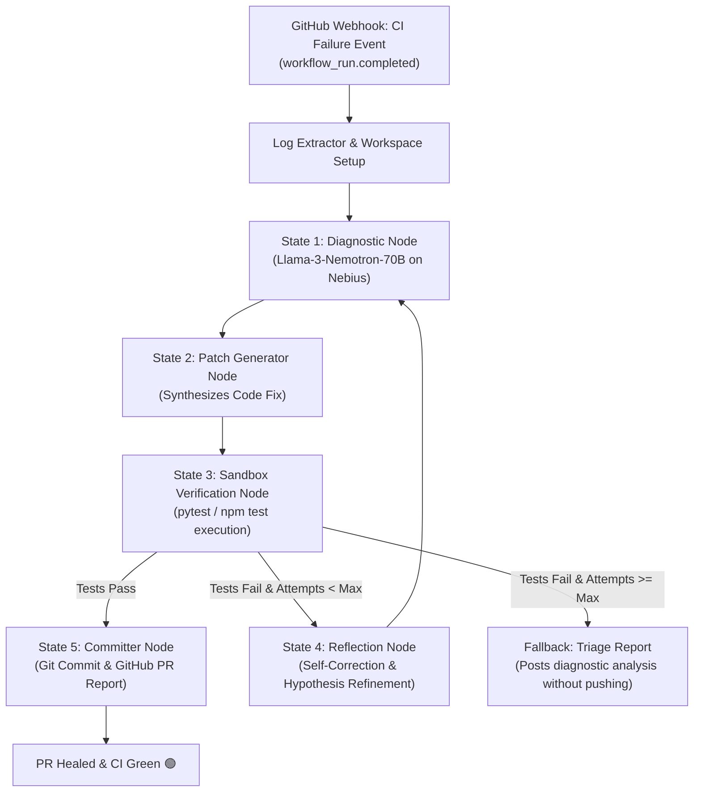

# 🛡️ RepoGuard AI — The Self-Healing CI/CD Agent

[](https://nebius.ai)
[](https://huggingface.co/nvidia/Llama-3.1-Nemotron-70B-Instruct)
[](https://github.com/langchain-ai/langgraph)
[](LICENSE)

> **RepoGuard AI** is an autonomous, self-correcting agent that monitors GitHub pull requests. When a CI/CD build or test suite fails, RepoGuard AI captures the error logs, clones the repo into an isolated sandbox, diagnoses the root cause using **Llama-3-Nemotron-70B-Instruct** (via Nebius API), generates minimal verified patches, tests them in an isolated test environment, reflects on errors, and commits the healed code back to the PR branch.

---

## 🎯 How RepoGuard AI Utilizes the Track

- **Self-Correction (Reflection) Loop**: Rather than blindly hallucinating a single-shot patch, RepoGuard AI runs a multi-turn reflection cycle. If an initial patch introduces a regression or fails boundary tests, the agent reflects on the error output, refines its hypothesis, and synthesizes a new fix.
- **Nebius Compute & Nemotron-70B**: Employs NVIDIA's Llama-3-Nemotron-70B-Instruct running on high-throughput Nebius GPU infrastructure for deep code reasoning and stack trace analysis.
- **Production-Grade Isolation**: Executes all verification inside isolated sandboxes (subprocess/Docker) before any commit touches git history.

---

## 🏗️ Architecture & State Machine



---

## ⚡ Tech Stack

| Layer | Technology | Role |
| :--- | :--- | :--- |
| **LLM & Reasoning** | **Llama-3-Nemotron-70B-Instruct** | Deep code comprehension, stack trace extraction, unified diff generation |
| **Inference & Compute** | **Nebius AI Studio / GPU Container** | High-throughput token generation and fast inference |
| **Agent Orchestration**| **LangGraph (StateGraph)** | Cyclic state machine, reflection loops, and conditional branching |
| **Execution Sandbox** | **Subprocess / Docker Runner** | Safe test execution (`pytest`, `jest`) preventing side-effects |
| **Integrations** | **FastAPI + GitHub REST API** | Webhooks (`workflow_run`), git branch management, and PR comments |
| **UI & Visualizer** | **Streamlit & Rich CLI** | Live reflection cycle visualizer and interactive terminal demo |

---

## 🚀 Quickstart Guide

### 1. Installation

Clone the repository and install dependencies:

```bash
git clone https://github.com/your-username/RepoGuard-AI.git
cd RepoGuard-AI
pip install -r requirements.txt
```

### 2. Configuration

Copy `.env.example` to `.env`:

```bash
cp .env.example .env
```

Add your credentials:
```ini
NEBIUS_API_KEY=your-nebius-token-here
NEBIUS_BASE_URL=https://api.studio.nebius.ai/v1
NEBIUS_MODEL=nvidia/Llama-3.1-Nemotron-70B-Instruct-HF

# Optional GitHub Integration
GITHUB_TOKEN=ghp_...
```

*(Note: RepoGuard AI includes an offline GPU simulation mode, allowing instant demonstration even without an active Nebius key!)*

---

## 💻 Running RepoGuard AI

### Option A: Interactive CLI Demo (Recommended for Judges)

Run the autonomous self-healing agent against the included buggy `demo_repo`:

```bash
python -m repoguard.cli demo
```

You will see:
1. Baseline test suite failing with `ZeroDivisionError`.
2. State 1: Nemotron-70B diagnosing the root cause.
3. State 2: Patcher synthesizing code modifications.
4. State 3: Sandbox running `pytest`.
5. State 4: Reflection loop analyzing regressions.
6. State 5: Verified commit and formatted GitHub PR comment.

---

### Option B: Interactive Streamlit Visualizer

Launch the live web visualizer:

```bash
streamlit run repoguard/dashboard/app.py
```

Features:
- Live side-by-side view of the broken repository source and test suite.
- One-click trigger for the autonomous reflection cycle.
- Step-by-step progress through each LangGraph node.
- Generated PR Markdown review comment with full reflection history.

---

### Option C: GitHub Webhook Server

Launch the production webhook listener:

```bash
python -m repoguard.cli server --port 8000
```

- Webhook endpoint: `POST /webhook`
- Manual trigger API: `POST /api/heal`
- Health check: `GET /health`

---

## 🧪 Testing the Agent

Run RepoGuard AI's internal test suite:

```bash
pytest tests/
```

---

## 📄 License

Apache License 2.0. Built for the Nebius / NVIDIA Hackathon.
